<div align="center">


[](https://github.com/Rayekkk/Ayaneo3Companion/releases/latest)
[](https://github.com/Rayekkk/Ayaneo3Companion/releases)
[](#requirements)
[](https://decky.xyz)
[](LICENSE)

**Your AYANEO 3 hardware controls, together in the Steam overlay.**
Tune power and cooling, set vibration and lighting, fix the rear buttons, manage the Magic Modules, charging, speakers and the OLED display without leaving Gaming Mode.

[Features](#features) · [Requirements](#requirements) · [Installation](#installation) · [Quick start](#quick-start) · [Modules](#using-the-modules) · [Troubleshooting](#troubleshooting) · [AI disclaimer](#ai-disclaimer)

</div>

---

## Features

AYANEO 3 Companion brings the console's hardware controls into one Decky plugin. Your
settings are saved and come back after startup, sleep and charger changes, also while the
menu is closed.

| Module | What you can do |
|---|---|
| [TDP](#tdp) | Choose a power preset or your own limits, set CPU Boost and CPU energy preference, and give games their own settings, also separately on battery and charger |
| [Fan Control](#fan-control) | Draw your own fan curve with touch or controller and see the APU temperature and fan speed |
| [Vibration](#vibration) | Set the controller's vibration strength and scale how strongly games vibrate |
| [Lighting](#lighting) | Set the stick-light effect, color and brightness |
| [Key binding](#key-binding) | Use LC, RC, LC1 and RC1 as four separate buttons, and undo an accidental TM press |
| [Magic Modules](#magic-modules) | See which modules are attached, eject either side and reset the controller |
| [Battery](#battery) | Power the console from the charger without charging the battery |
| [Audio](#audio) | Load AYANEO's own speaker tuning and recalibrate the speakers |
| [OLED display](#oled-display) | Install the OLED color and refresh-rate definition and fix the HDR brightness games read |

## Requirements

| Requirement | Details |
|---|---|
| Device | AYANEO 3 OLED (Ryzen 7 8840U and Ryzen AI 9 HX 370 variants) |
| System | SteamOS or Bazzite in Gaming Mode, with [Decky Loader](https://decky.xyz) |
| Fan Control | The kernel's `ayaneo-ec` fan interface (tested on SteamOS 3.10, kernel 7.2.4) |

Companion works only on the AYANEO 3; other AYANEO handhelds are refused, even when they
look similar to the system. Each page explains when a control is unavailable on your console.

## Installation

1. Install [Decky Loader](https://decky.xyz) if you do not already have it.
2. Download `Ayaneo3Companion-<version>.zip` from [Releases](https://github.com/Rayekkk/Ayaneo3Companion/releases).
3. In Gaming Mode, open **Quick Access Menu → Decky → Settings → Developer**.
4. Choose **Install plugin from ZIP**, select the archive, then open **AYANEO 3 Companion** in Decky.

<details>
<summary><b>Installing without the Quick Access button</b></summary>

On a fresh system the QAM button may not work before Companion fixes the key binding. Copy
`bootstrap.sh` and the ZIP to the console and run:

```bash
chmod +x bootstrap.sh
./bootstrap.sh Ayaneo3Companion-1.3.0.zip
```

Decky Loader must already be installed. The installer checks the device and the whole ZIP,
replaces the plugin in one step and puts the previous version back if anything fails. In
Desktop Mode you can instead keep the ZIP, `bootstrap.sh` and `Install AYANEO 3 Companion.desktop`
in one folder and double-click the launcher.

</details>

### Updating

1. Open **About → Check for updates**.
2. Download the new version; the ZIP appears in your Downloads folder.
3. Install it through **Decky Settings → Developer → Install plugin from ZIP**.

Companion keeps its settings across updates. Only stable releases are offered, and the ZIP's
version, size, SHA-256 digest and contents are checked before it is saved.

### Uninstalling

Uninstall **AYANEO 3 Companion** in **Decky Settings → Plugins**. Before it stops, Companion
hands the hardware back: the fan returns to the console's automatic curve, charge bypass is
turned off, CPU Boost and EPP return to the values they had before Companion changed them,
lighting and vibration return to what Companion found when it first ran, LC1/RC1 are cleared,
and its key-binding map, speaker tuning path and OLED display definition are removed. Decky
handles an update as uninstall plus install, so Companion never deletes your settings on its
own: they stay in `~/homebrew/settings/Ayaneo3Companion/`, its root-only files in
`/var/lib/ayaneo3companion-tdp/`, `/var/lib/ayaneo3-companion/` and
`/var/log/ayaneo3companion/`, and its backups in `/home/.ayaneo3companion-backups/`. Delete
those folders after uninstalling for a full cleanup. A speaker calibration stays in the
console's firmware; keep the backups folder if you may want the original values back.

## Quick start

Open Companion in Decky. **Hardware controls** shows a short status for each module. Select a
row to open its page and use **‹ All Controls** to go back.

<a href="docs/screenshots/overview.png">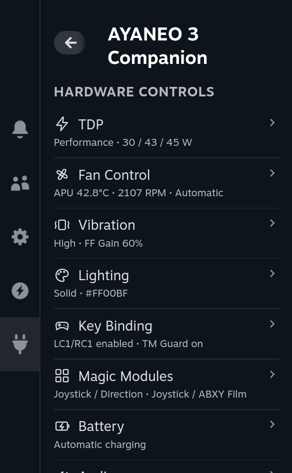</a>

1. Turn on **Fix key binding** on **Key binding** so LC1/RC1 and the QAM button work.
2. Turn on **Install display definition** on **OLED display** and restart Gaming Mode when asked.
3. For game-specific power, start the game first and choose **This game** on **TDP**.
4. For custom cooling, open **Fan Control**, check the curve, save any edits, then turn on **Enable fan control**.

The screenshots in this guide show the Quick Access panel at full size: click one to open it.

## Using the modules

### TDP

Turn on **Enable TDP control**, then pick a preset. The line under the switch shows what runs
now and the live APU power.

<a href="docs/screenshots/tdp.png">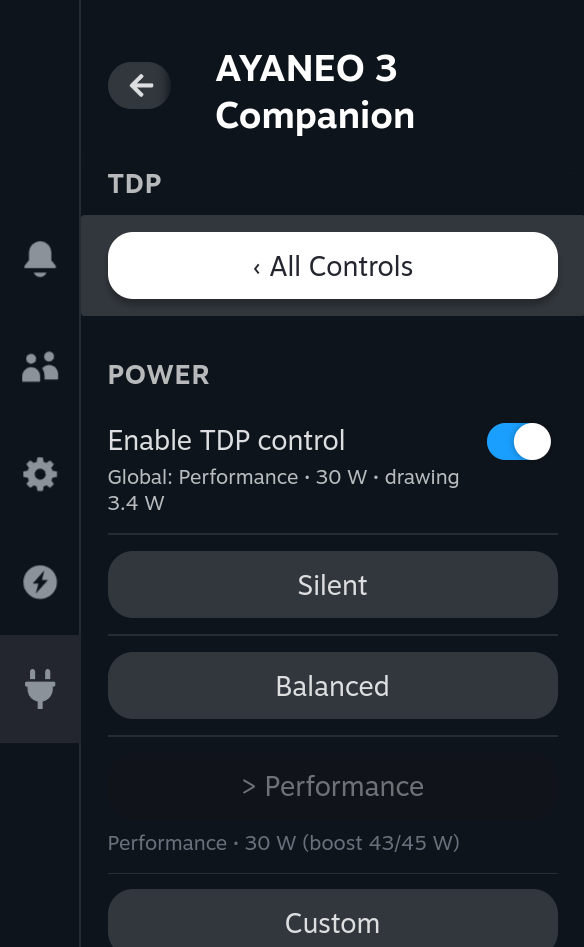</a>

| Preset | Sustained | Slow boost | Fast boost |
|---|---|---|---|
| Silent | 10 W | 15 W | 20 W |
| Balanced | 15 W | 25 W | 30 W |
| Performance | 30 W | 43 W | 45 W |

- A preset applies and saves as soon as you press it.
- **Custom** opens sliders for your own limits (5–30 W sustained, up to 43 W slow and 45 W fast
  boost); press **Apply** to use them. **Separate boost limits** switches between one slider and three.
- **Settings for &lt;game&gt;** (while a game runs) chooses **Global**, **This game**, or
  **This game + charger** for different settings on battery and on charger. **Global** keeps
  the game's settings unused instead of deleting them.
- **CPU Boost** turns turbo frequencies on or off. **CPU energy preference** leans towards CPU
  speed or leaves more power for the GPU.

<details>
<summary><b>TDP details</b></summary>

The ceilings are the ones the console's SMU accepts, measured on the Ryzen 7 8840U. The
AYANEO 3 has no firmware TDP interface, so Companion writes the limits with a pinned,
checksum-verified `ryzenadj` that it downloads once. The firmware lowers the sustained limit
to 28 W on every charger change, so Companion writes the limits again after each power-source
change and after sleep. While PowerStation (another TDP service) runs, TDP changes are refused
and the page says why; CPU Boost and EPP stay available. Settings from 1.2.x are carried over
once.

</details>

### Fan Control

Fan Control starts with the **Balanced** curve and stays off until you turn it on.

<a href="docs/screenshots/fan-control.png">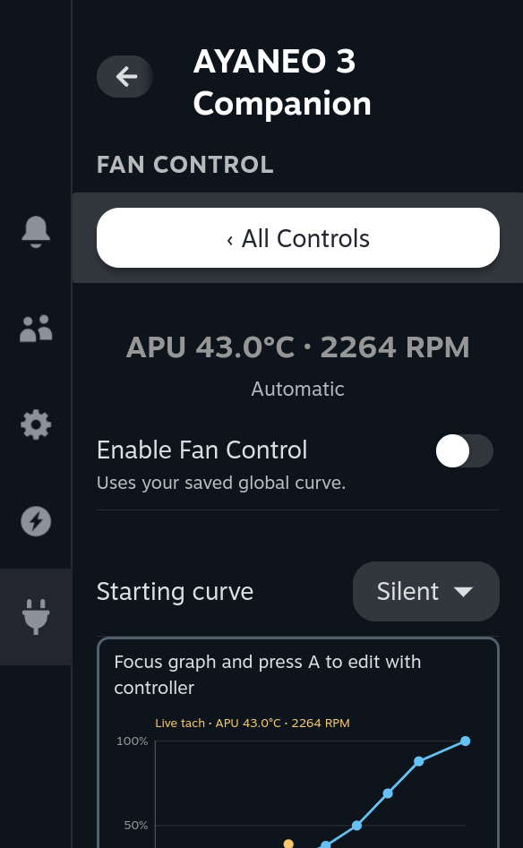</a>

1. Check the curve, adjust it if you like and press **Save global curve**.
2. Turn on **Enable fan control**. Turn it off at any time to return the fan to the console's automatic curve.

The graph has **8 points from 0 to 100°C** in percent of full speed. Drag a point, or focus
the graph and use the controller:

| Control | Action |
|---|---|
| A | Start editing points |
| LB / RB | Select the previous / next point |
| D-pad left / right | Change the temperature by 1°C |
| D-pad up / down | Change the speed by the selected step |
| B | Finish editing |

**Starting curve** offers **Silent**, **Balanced** and **Aggressive**. **Full screen curve
editor** gives you more room.

<a href="docs/screenshots/fan-curve-editor.png">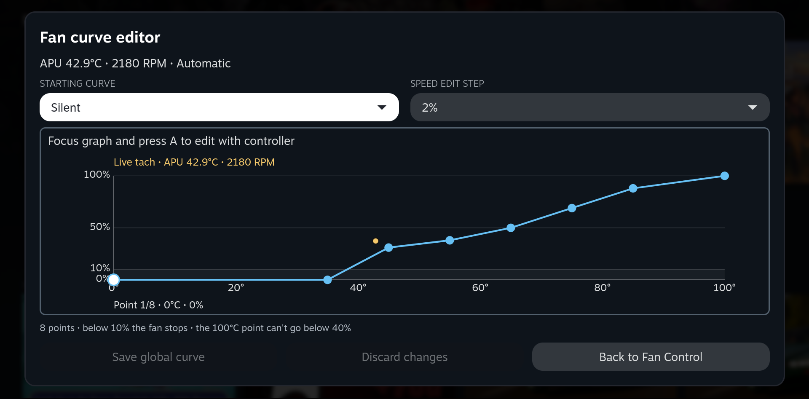</a>

<details>
<summary><b>Curve rules, presets and safety</b></summary>

Below 10% the fan stops; the 100°C point cannot go below 40%, and at 100°C the fan runs at
full speed whatever the curve says. Temperatures stay in order and speeds can only stay equal
or rise. **Settings → Assign curves to TDP presets** gives each TDP preset its own curve.

The curve runs in its own process, watched by an independent backup. Either one returns the
fan to automatic when the other stops, when the plugin unloads, before sleep or after a fault,
and the page says why. Known fan programs (jupiter-fan-control, HHD, fancontrol) block Fan
Control instead of competing with it.

</details>

### Vibration

Choose the controller's **Vibration** strength (Off, Low, Medium, High). **FF Gain** scales
the vibration games send, in 10% steps, without changing the strength. **Test vibration**
plays a short buzz.

<a href="docs/screenshots/vibration.png">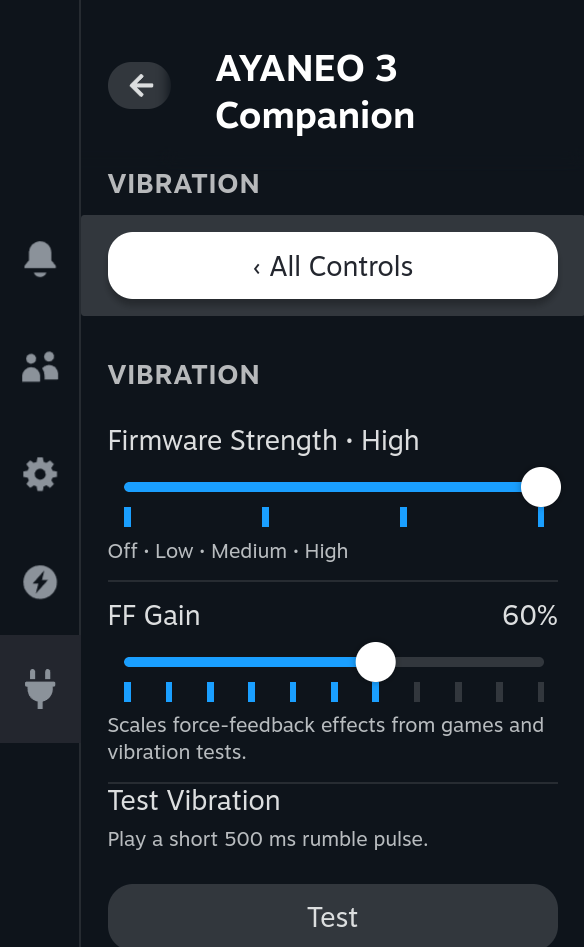</a>

### Lighting

Turn on **Enable LED control** and choose an **LED mode** (Solid, Pulse or Rainbow), then
set **Hue**, **Saturation** and **Brightness**. Changes save automatically.

<a href="docs/screenshots/lighting.png">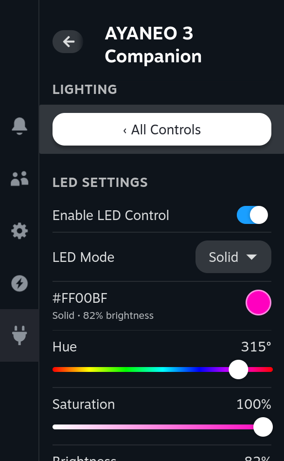</a>

Until you change something here, Companion leaves the controller's own lighting and vibration alone.

### Key binding

**Fix key binding** makes LC, RC, LC1 and RC1 four separate buttons; Steam shows them under
those names. Both QAM button variants of the firmware are recognised.

**TM Guard** (on by default) undoes an accidental press of the TM button: it switches the
controller back to the gamepad mode and restores your lighting, vibration and buttons. The
controller is off for about two seconds while it does. Turn TM Guard off when you want to use
a TM mode on purpose.

<a href="docs/screenshots/key-binding.png">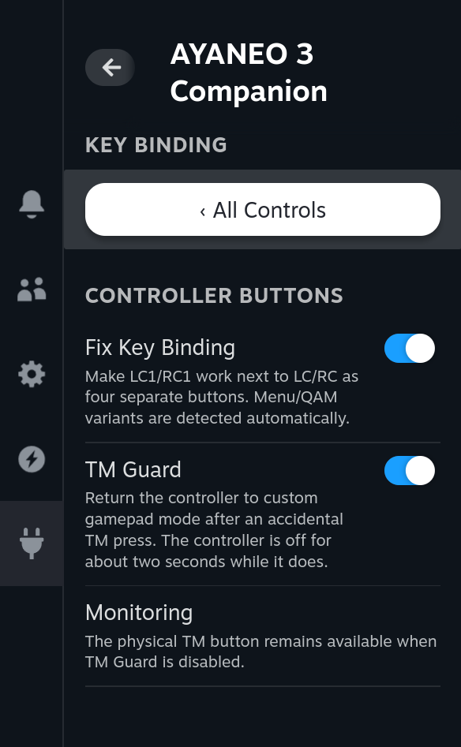</a>

### Magic Modules

The page shows which module is attached on each side and how it is turned. **Eject Left**,
**Eject Right** and **Eject Both** release the modules; insert them again and Companion powers
the controller up and restores your settings. **Reset Magic Modules** restarts the controller
without releasing a module.

<a href="docs/screenshots/magic-modules.png">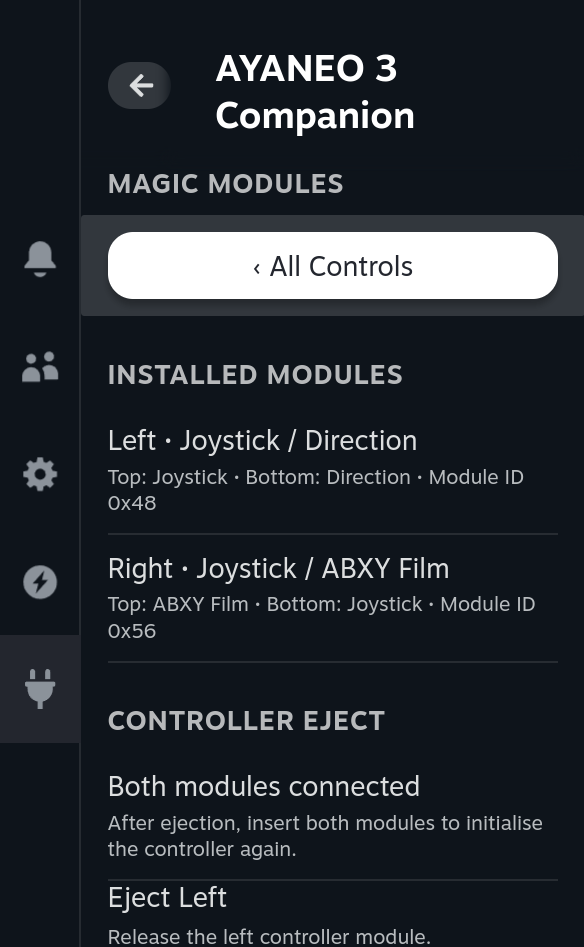</a>

### Battery

The first row shows the battery level, charging power and the time to full while charging.
**Bypass charging** powers the console from the charger without charging the battery.

<a href="docs/screenshots/battery.png">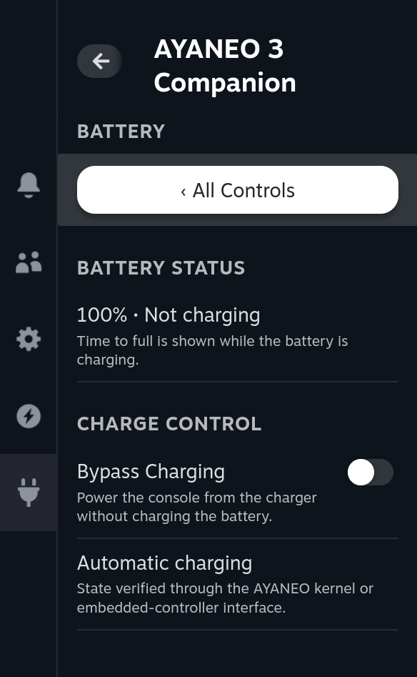</a>

Each change is read back from the hardware. Uninstalling Companion turns bypass off.

### Audio

**AYANEO speaker tuning** loads AYANEO's own profile for both speaker amplifiers instead of the
generic one SteamOS uses. **Reapply audio fix** loads it again if the system reset the audio.

<a href="docs/screenshots/audio.png">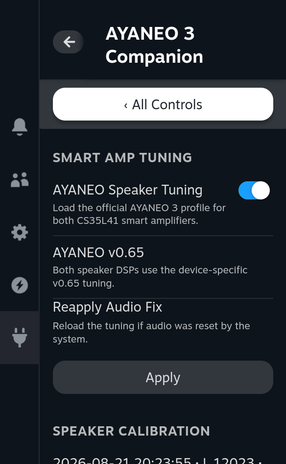</a>

**Recalibrate audio** measures both speakers again. Put the console on a clear surface in a
quiet room, press **Start** and confirm. Restart the console afterwards so the driver uses the
new values.

<details>
<summary><b>Calibration safety</b></summary>

Calibration is offered only after both amplifiers report the tuned profile. It rejects
implausible results, keeps both amplifier IDs and saves the original values to
`/home/.ayaneo3companion-backups/audio-calibration` before every write (`/home` survives
SteamOS updates). The calibration file comes from HHD's firmware repository and is checked
against a pinned SHA-256 digest.

</details>

### OLED display

**Install display definition** installs a gamescope definition for the AYANEO 3 OLED: Gamma 2.2
colors, HDR and 60/90/120/144 Hz. It is stored in your home folder, so SteamOS updates keep it.
The HDR fix makes games read AYANEO's advertised 800-nit maximum.

<a href="docs/screenshots/oled-display.png">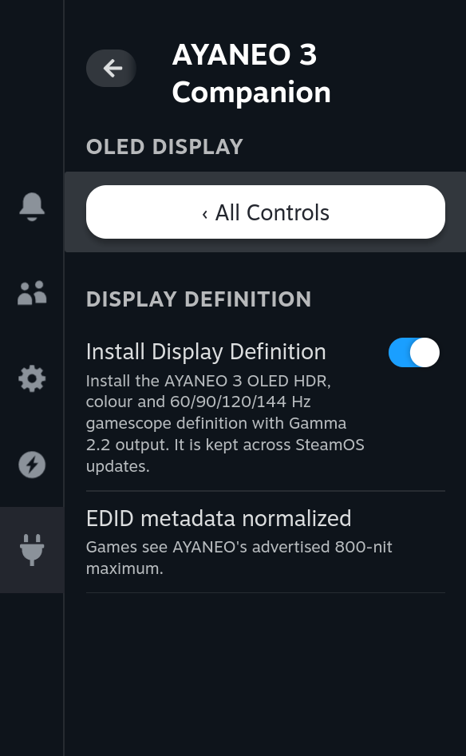</a>

> [!IMPORTANT]
> gamescope loads the definition when it starts. When the page offers **Restart Gaming Mode**,
> it asks first, then closes Steam and running games. Save your games first.

If SteamOS ever ships its own AYANEO 3 profile, Companion leaves the display to it and keeps
only the HDR fix. Turning the switch off puts back a definition that Companion replaced.

### About

**About** shows the installed version and checks for updates as described in [Updating](#updating).

## Troubleshooting

| What you see | What to do |
|---|---|
| LC1/RC1 or the QAM button do nothing | Turn on **Fix key binding**. After a SteamOS update Companion reinstalls it at startup. |
| The controller changed mode after a TM press | Keep **TM Guard** on; it switches back within a few seconds. |
| "Could not leave TM mode; press TM until the light is white" | TM Guard stopped after three attempts. Press TM until the light is white. |
| An arrow key stays pressed after TM mode | TM Guard clears it by restarting the controller. With TM Guard off, turn it on or restart the console. |
| Controller controls are unavailable | The kernel's `hid-ayaneo` driver owns the controller. FF Gain still works. |
| TDP changes are refused | PowerStation controls TDP; stop it to use Companion's TDP. |
| Fan Control is blocked | Stop the other fan program (jupiter-fan-control, HHD, fancontrol). |
| Fan Control is not available | Your kernel has no `ayaneo-ec` fan interface yet; see [Requirements](#requirements). |
| My curve is saved but the fan is on Automatic | Saving does not turn Fan Control on. Turn on **Enable fan control**. |
| The battery does not charge | Turn off **Bypass charging**. Disabling the plugin keeps bypass on; uninstalling turns it off. |
| Colors did not change | Restart Gaming Mode when the OLED display page asks. |
| Calibration made no difference | Restart the console; the driver reads the new values at boot. |
| The controller stays off after Eject | Insert both modules fully, or use **Reset Magic Modules**. |
| Update check or download failed | Read the error and retry, or download the ZIP from Releases. |

**Reporting a problem:** include the plugin version, SteamOS version, processor variant, what
the page says and what you did. [CHANGELOG.md](CHANGELOG.md) lists the changes in each version.

## How it works

<details>
<summary><b>Hardware interfaces and background work</b></summary>

| Area | System interface |
|---|---|
| TDP | Verified `ryzenadj` writing SPL, SPPT and FPPT |
| CPU Boost / EPP | Kernel CPUFreq controls under sysfs |
| Fan Control | `pwm1` of the `ayaneo-ec` hwmon interface, every value read back |
| Vibration, lighting, TM Guard, buttons, modules | AYANEO's vendor HID protocol; FF Gain through Linux `FF_GAIN` |
| Magic Module power | `ayaneo-ec` sysfs, or the EC directly on older kernels |
| Key bindings | An extension of InputPlumber's `aya7` capability map |
| Charge bypass | The kernel `charge_behaviour` attribute, or the same EC register on older kernels |
| Speakers | CS35L41 tuning files already in SteamOS; calibration in the Cirrus EFI variable |
| OLED | A gamescope display script and gamescope's published EDID copy |

Settings are written atomically with a last-good backup; if neither copy can be read, hardware
changes stop and the panel explains why. Every controller write is confirmed by the
controller's own status report, not by an acknowledgement alone. Background monitors keep TDP,
charge bypass, the controller and FF Gain as saved after startup, sleep, charger changes and
module swaps. Page refreshes pause while Quick Access is hidden.

TM Guard watches the controller's mode. When TM leaves the gamepad mode, it cuts the
controller's power through the EC for two seconds, switches back, resets the gamepad's USB port
and reprograms the buttons. Without the power cycle a D-pad direction from TM mode could stay
latched as a held arrow key. It stops after three attempts in a row.

The updater accepts only this plugin's stable release ZIP and checks its SHA-256 digest, paths,
sizes and plugin identity before saving it.

</details>

## Development

<details>
<summary><b>Build, test and package from source</b></summary>

Requires Node.js 24 and Python 3.14.

```bash
npm ci --ignore-scripts --no-audit --no-fund
npm run typecheck      # frontend types
npm run test:frontend  # frontend regression suites
npm run test:backend   # Python backend tests
npm run build          # compile the frontend
npm run package        # create artifacts/Ayaneo3Companion-<version>.zip
```

Install the result through Decky's **Install plugin from ZIP**. `npm run check` runs all of it. GitHub Actions runs the backend
tests on Linux and Windows and checks the frontend and the built ZIP. Hardware calls are
mocked, so startup, sleep, charger changes, module swaps and the controller still need testing
on an AYANEO 3.

</details>

---

## Credits

- [LegionGo2Companion](https://github.com/Rayekkk/LegionGo2Companion) - TDP Control, Fan Control and the panel layout
- [Handheld Daemon (HHD)](https://github.com/hhd-dev/hhd) - prior art for the AYANEO 3 controller protocol and module table; no HHD code is included
- [HHD hardware firmware](https://github.com/hhd-dev/hwfirm) - the speaker calibration file, downloaded at runtime
- [RyzenAdj](https://github.com/FlyGoat/RyzenAdj), [InputPlumber](https://github.com/ShadowBlip/InputPlumber), the Linux `ayaneo-ec` driver and [Decky Loader](https://github.com/SteamDeckHomebrew/decky-loader) - the supporting tools and interfaces

Component licenses are recorded in [NOTICE](NOTICE).

---

## License

BSD 3-Clause - see [LICENSE](LICENSE) and [NOTICE](NOTICE).

---

## AI disclaimer

This project was built with substantial help from AI coding assistants. Most of the code,
tests and documentation were written by AI agents (first OpenAI Codex, later Anthropic's
Claude Code) working under my direction: I defined what each feature should do, made the
design and safety decisions, reviewed the results and chose what was released.

The AI was used to:

- write and refactor the Python backend and the Decky panel, and port TDP and Fan Control
  from LegionGo2Companion;
- build the automated test suites (more than 600 tests run on Linux and Windows for every change);
- audit the code for bugs, security issues and wasted work, with every finding checked by
  independent review passes and, where possible, reproduced before it was fixed;
- research hardware interfaces and write this documentation.

Nothing here is untested AI output. I tested the plugin continuously on my own AYANEO 3
throughout development: in Gaming Mode, across sleep, restarts, plugin updates and
reinstalls, with games and HDR content, module swaps and TM presses. Hardware-facing features
(power limits, fan control, charging, speaker calibration, display) were held back until they
behaved correctly on the real device, and safety rules such as returning the fan to automatic
on any failure and reading back every hardware write were kept as hard requirements.

Even so, Companion controls power, cooling, charging and speaker calibration on your console.
It is provided as is, without warranty (see [License](#license)); use it at your own risk.
